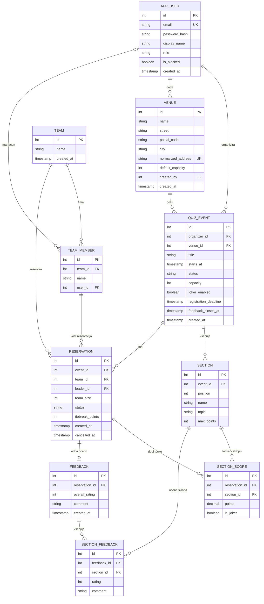

# KvizHub: podatkovni model

## 1. Izbira podatkovne baze

Podatke hranimo v relacijski bazi **PostgreSQL**. Entitete so med seboj močno povezane (uporabniki, ekipe, dogodki, rezervacije, točke, ocene), kapaciteto dogodka je treba varno upravljati ob hkratnih rezervacijah (transakcije). Podrobnejša utemeljitev je v dokumentu `04-arhitektura-in-tehnoloski-sklad.md`.

## 2. Pregled entitet

| Entiteta | Namen |
|---|---|
| `app_user` | Uporabnik platforme z eno vlogo (kvizmaster, vodja ekipe, administrator). |
| `team` | Ekipa, ki se prijavlja na dogodke. |
| `team_member` | Član ekipe. Član z računom povezuje uporabnika z ekipo. Za člana račun ni nujen. |
| `venue` | Lokal, v katerem poteka kviz. Isti lokal gosti dogodke različnih kvizmastrov. |
| `quiz_event` | Dogodek kviza: termin, lokal, kapaciteta, stanje in nastavitev jokerja. |
| `section` | Sklop dogodka s temo in največjim številom točk. |
| `reservation` | Rezervacija mize ene ekipe za en dogodek. Beleži tudi prisotnost in vodjo ekipe za ta večer. |
| `section_score` | Točke ekipe (rezervacije) v posameznem sklopu. |
| `feedback` | Ocena celotnega večera, ki jo odda vodja prisotne ekipe. |
| `section_feedback` | Ocena posameznega sklopa znotraj povratne informacije. |

Lestvica ni samostojna entiteta. Izračuna se iz tabele `section_score`: vsota točk po sklopih (točke sklopa z jokerjem se podvojijo) in `tiebreak_points`.

## 3. Opis entitet

### app_user

| Polje | Tip | Opomba |
|---|---|---|
| `id` | integer, PK | |
| `email` | varchar | enoličen |
| `password_hash` | varchar | geslo je shranjeno samo kot zgoščena vrednost |
| `display_name` | varchar | |
| `role` | varchar | `quizmaster`, `team_leader`, `admin` |
| `is_blocked` | boolean | privzeto `false` |
| `created_at` | timestamptz | |

### team

| Polje | Tip | Opomba |
|---|---|---|
| `id` | integer, PK | |
| `name` | varchar | |
| `created_at` | timestamptz | |

### team_member

| Polje | Tip | Opomba |
|---|---|---|
| `id` | integer, PK | |
| `team_id` | integer, FK → `team` | |
| `name` | varchar | |
| `user_id` | integer, FK → `app_user`, nullable | opcijsko. Član z računom je edina povezava med uporabnikom in ekipo. Samo tak član lahko rezervira kot vodja ekipe. Omogoča tudi kasnejšo nadgradnjo, da ima ekipo v upravljanju več uporabnikov. |

### venue

| Polje | Tip | Opomba |
|---|---|---|
| `id` | integer, PK | |
| `name` | varchar | |
| `street` | varchar | |
| `postal_code` | varchar | |
| `city` | varchar | |
| `normalized_address` | varchar | enoličen. Naslov brez šumnikov, ločil in razlik v velikosti črk, da se prepreči podvajanje lokalov. |
| `default_capacity` | integer | privzeta kapaciteta, ki se kopira v nov dogodek |
| `created_by` | integer, FK → `app_user` | kvizmaster, ki je lokal dodal |
| `created_at` | timestamptz | |

### quiz_event

| Polje | Tip | Opomba |
|---|---|---|
| `id` | integer, PK | |
| `organizer_id` | integer, FK → `app_user` | kvizmaster |
| `venue_id` | integer, FK → `venue` | |
| `title` | varchar | |
| `starts_at` | timestamptz | |
| `status` | varchar | `draft`, `published`, `registrations_closed`, `in_progress`, `finished`, `feedback_open`, `archived` |
| `capacity` | integer | število mest. Kapaciteta se lahko razlikuje med večeri. |
| `joker_enabled` | boolean | privzeto `false`. Določa, ali dogodek uporablja joker. |
| `registration_deadline` | timestamptz, nullable | rok za prijavo in odjavo |
| `feedback_closes_at` | timestamptz, nullable | konec okna za ocenjevanje |
| `created_at` | timestamptz | |

### section

| Polje | Tip | Opomba |
|---|---|---|
| `id` | integer, PK | |
| `event_id` | integer, FK → `quiz_event` | |
| `position` | smallint | zaporedna številka sklopa v dogodku. Enolična znotraj dogodka. |
| `name` | varchar | |
| `topic` | varchar | tema, po kateri se povzemajo povratne informacije |
| `max_points` | integer | |

### reservation

| Polje | Tip | Opomba |
|---|---|---|
| `id` | integer, PK | |
| `event_id` | integer, FK → `quiz_event` | |
| `team_id` | integer, FK → `team` | |
| `leader_id` | integer, FK → `team_member` | član ekipe, ki jo ta večer zastopa (vodja ekipe). Mora pripadati isti ekipi in imeti uporabniški račun. |
| `team_size` | smallint | število mest, ki jih rezervacija porabi. Vsota potrjenih rezervacij ne sme preseči kapacitete dogodka. |
| `status` | varchar | `confirmed`, `attended`, `waitlisted`, `no_show`, `cancelled` |
| `tiebreak_points` | integer | privzeto 0. Dodatna točka ob izenačenju, razrešenem na dogodku. |
| `created_at` | timestamptz | |
| `cancelled_at` | timestamptz | čas odjave. Pri stanju no_show loči pozno odjavo od dejanskega izostanka. |

Ekipa ima na dogodek največ eno rezervacijo (enoličen par `event_id`, `team_id`). Če ekipa po preklicu ponovno rezervira, se uporabi ista vrstica s stanjem `confirmed`.

### section_score

| Polje | Tip | Opomba |
|---|---|---|
| `id` | integer, PK | |
| `reservation_id` | integer, FK → `reservation` | |
| `section_id` | integer, FK → `section` | |
| `points` | numeric | |
| `is_joker` | boolean | privzeto `false`. Ekipa ima lahko joker v največ enem sklopu, če dogodek joker uporablja. |

Vnos točk je en na rezervacijo in sklop (enoličen par `reservation_id`, `section_id`).

### feedback

| Polje | Tip | Opomba |
|---|---|---|
| `id` | integer, PK | |
| `reservation_id` | integer, FK → `reservation` | enoličen, torej ena ocena na rezervacijo. Možna samo za rezervacijo v stanju `attended` in do `feedback_closes_at`. Oceno odda vodja rezervacije. |
| `overall_rating` | smallint | 1–5 |
| `comment` | text, nullable | |
| `created_at` | timestamptz | |

### section_feedback

| Polje | Tip | Opomba |
|---|---|---|
| `id` | integer, PK | |
| `feedback_id` | integer, FK → `feedback` | |
| `section_id` | integer, FK → `section` | |
| `rating` | smallint | 1–5 |
| `comment` | text, nullable | |

## 4. Povezave med entitetami

- `team` 1 : N `team_member`
- `app_user` 1 : N `team_member` (opcijsko, član lahko ima račun)
- `app_user` 1 : N `quiz_event` (kvizmaster organizira dogodke)
- `app_user` 1 : N `venue` (kvizmaster doda lokal)
- `venue` 1 : N `quiz_event` (lokal gosti več dogodkov)
- `quiz_event` 1 : N `section`
- `quiz_event` N : M `team` prek `reservation`
- `team_member` 1 : N `reservation` (član je vodja ekipe pri rezervaciji)
- `reservation` N : M `section` prek `section_score`
- `reservation` 1 : 0..1 `feedback`
- `feedback` 1 : N `section_feedback`
- `section` 1 : N `section_feedback`

## 5. ER diagram

