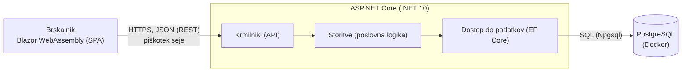

# KvizHub: arhitektura in tehnološki sklad

## 1. Arhitektura

KvizHub bi bil razvit kot spletna aplikacija z ločenim odjemalcem in REST API-jem. Backend je ena aplikacija z notranjo plastno zgradbo (modularni monolit), ne več samostojnih storitev.

### Glavni deli sistema

| Del | Naloga |
|---|---|
| **Odjemalec** | Enostranska aplikacija (SPA) v brskalniku. Prikazuje uporabniški vmesnik za vse tri vloge in kliče API. O poslovnih pravilih ne odloča. |
| **REST API (backend)** | Sprejema zahtevke, preverja prijavo in vlogo ter izvaja poslovno logiko. Sestavljajo ga tri plasti: **krmilniki** (poti API-ja), **storitve** (poslovna logika: prehodi stanj dogodka, kapaciteta, pravilo ocene, izračun lestvice) in **dostop do podatkov**. |
| **Podatkovna baza** | Hrani vse podatke po modelu iz dokumenta `03-podatkovni-model.md`. |

### Komunikacija med deli

- **Odjemalec ↔ API:** REST prek HTTPS, podatki v obliki JSON. Razredi za prenos podatkov (DTO) so v skupnem projektu, ki ga uporabljata odjemalec in backend.
- **API ↔ baza:** SQL prek ORM-ja, rezervacija in preverjanje kapacitete potekata v eni transakciji.

### Diagram



### Podatkovna baza
 
Podatke hranimo v relacijski bazi PostgreSQL. Entitete so močno povezane (uporabniki, ekipe, dogodki, rezervacije, točke, ocene), kapaciteta dogodka pa mora biti varna pri hkratnih rezervacijah, kar omogočajo transakcije. Shemo ustvarjajo migracije, ki so del kode.

### Avtentikacija in upravljanje uporabnikov

- **Računi:** ASP.NET Core Identity, preslikan na tabelo `app_user`. Polja `email`, `password_hash` in `role` ostanejo, Identity pa doda nekaj tehničnih stolpcev (npr. normalizirana e-pošta).
- **Registracija in prijava:** uporabnik se registrira z e-pošto in geslom kot kvizmaster ali vodja ekipe. Administrator se ustvari ob zagonu aplikacije (začetni podatki). Geslo je shranjeno samo kot zgoščena vrednost.
- **Seja:** po prijavi backend nastavi piškotek seje. Odjemalec žetonov ne hrani.
- **Vloge:** vlogo in lastništvo preveri backend pri vsakem zahtevku (npr. kvizmaster ureja samo svoje dogodke, vodja ekipe vidi samo rezervacije svoje ekipe). Odjemalec le skrije nedostopne dele vmesnika.
- **Blokiranje:** administrator lahko uporabnika blokira (`is_blocked`), blokiran uporabnik se ne more več prijaviti.

### Lokalni zagon
 
Zahteve: .NET SDK 10 in Docker.
 
```bash
# Start PostgreSQL in a container
docker compose up -d
 
# Create or update the database schema
dotnet ef database update
 
# Run the API, which also serves the client application
dotnet run
```
 
Povezava do baze in druge nastavitve so v uporabniških skrivnostih ali datoteki `.env`, ne v repozitoriju. Ob prvem zagonu se ustvari tudi administratorski račun.

## 2. Tehnološki sklad

| Del | Tehnologija |
|---|---|
| **Frontend** | Blazor WebAssembly (SPA, C#, .NET 10), odziven CSS (Bootstrap ali MudBlazor) |
| **Backend** | ASP.NET Core Web API (C#, .NET 10) |
| **Dostop do baze** | Entity Framework Core z ponudnikom Npgsql, migracije |
| **Podatkovna baza** | PostgreSQL |
| **Avtentikacija** | ASP.NET Core Identity, seja v piškotku |
| **Lokalni razvoj** | Docker Compose za PostgreSQL, .NET SDK 10, `dotnet watch`, Visual Studio ali Rider, DataGrip za delo z bazo |
| **Drugo** | OpenAPI (dokumentacija API-ja), xUnit (testi poslovne logike), Git |

## 3. Arhitekturne odločitve

Podrobne utemeljitve z obravnavanimi alternativami in posledicami so zapisane kot ADR v direktoriju [`adr/`](adr/).

- **Ločen odjemalec in REST API.** Jasna meja med vmesnikom in logiko, API pa lahko kasneje uporabi tudi mobilna aplikacija ali PWA, ki sta med nadgradnjami.
- **Modularni monolit namesto mikrostoritev.** Rezervacija in preverjanje kapacitete zahtevata eno transakcijo, kar je v eni aplikaciji preprosto. Mikrostoritve bi za ta obseg samo povečale zahtevnost zagona in vzdrževanja.
- **Poslovna logika samo v backendu.** Prehodi stanj dogodka, kapaciteta, pravilo ocene (prisotna ekipa, enkrat, v oknu) in lestvica so v storitvah. Odjemalec lahko pravila le prikaže, nikoli ne odloča o njih.
- **PostgreSQL.** Relacijski model ustreza močno povezanim podatkom, transakcije omogočajo varno rezervacijo, EF Core pa ga dobro podpira. 
- **Blazor WebAssembly in .NET.** Celoten sklad je v C#, odjemalec in backend si delita razrede za prenos podatkov. Kasneje je mogoče znanje komponent uporabiti v mobilni aplikaciji (MAUI Blazor Hybrid).
- **ASP.NET Core Identity in piškotek.** Zgoščevanje gesel, prijava in vloge so že rešeni in preverjeni, zato ne pišemo lastne varnostne kode. Piškotek je primeren, ker sta odjemalec in API na istem izvoru.
- **Brez realnočasovne komunikacije.** Kviz poteka na papir, zato WebSockets ali podobni mehanizmi niso potrebni.
- **Docker Compose za bazo.** Vsi razvijalci imajo isto različico PostgreSQL brez ročne namestitve, zagon pa je en ukaz.
