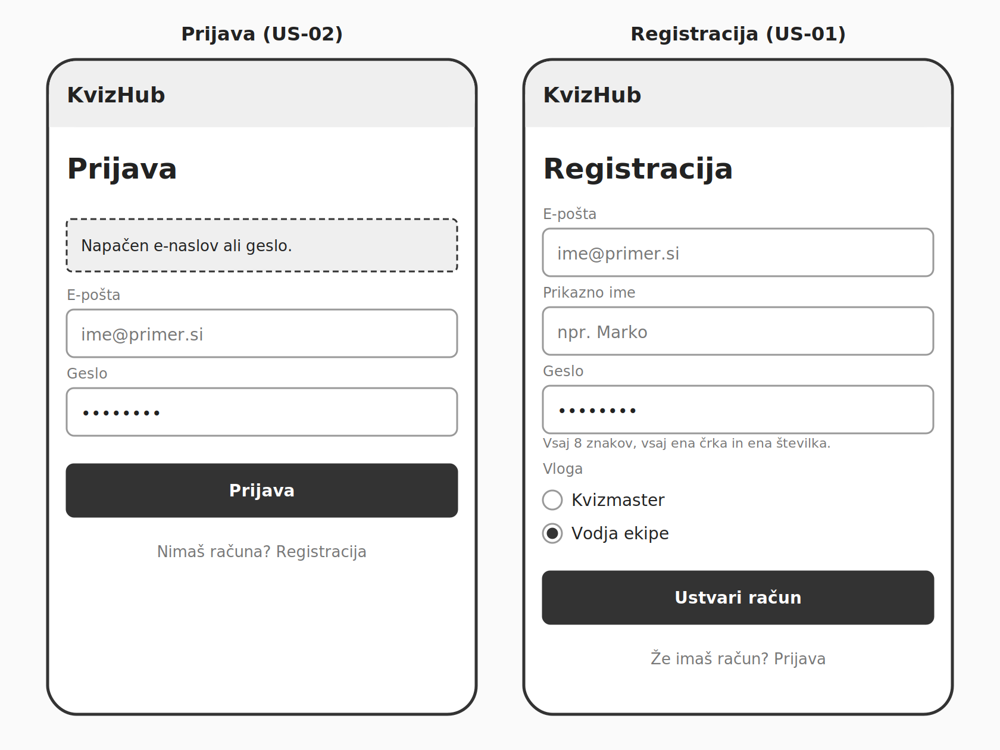
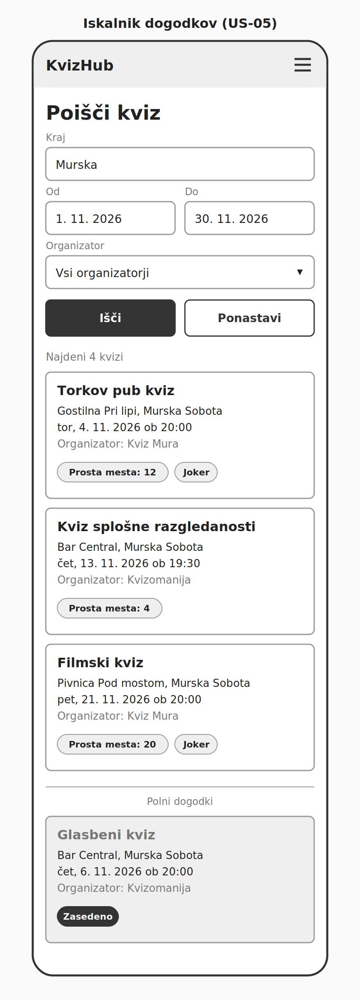
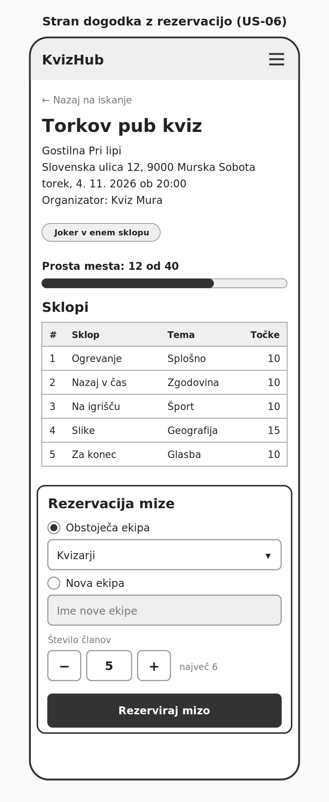

# KvizHub: wireframes

Wireframi prikazujejo osnovno postavitev ključnih zaslonov MVP. Narisani so v nizki ločljivosti (sivine, brez končnega oblikovanja) in v mobilni postavitvi, ker vodje ekip dogodke iščejo in rezervirajo večinoma s telefona. Podatki na zaslonih so izmišljeni.

## 1. Prijava in registracija

**Povezani zgodbi:** US-01, US-02

Levo je prijavni obrazec z e-pošto in geslom, prikazan v stanju po neuspešni prijavi. Sporočilo je enotno in ne izda, kateri podatek je napačen. Desno je registracija, kjer uporabnik poleg e-pošte, prikaznega imena in gesla izbere vlogo kvizmaster ali vodja ekipe. Vloge administrator ni mogoče izbrati. Pod poljem za geslo je izpisano pravilo za geslo. Zaslona sta dostopna brez prijave, zato v glavi ni menija.

## 2. Iskalnik dogodkov

**Povezana zgodba:** US-05

Začetna stran vodje ekipe. Na vrhu so filtri po kraju, obdobju in organizatorju ter gumba za iskanje in ponastavitev filtrov. Vsaka kartica prikazuje naslov, lokal s krajem, datum in uro, organizatorja, število prostih mest in oznako jokerja, če ga dogodek uporablja. Dogodki s prostimi mesti so na vrhu, razvrščeni po datumu. Polni dogodki so ločeni na koncu seznama in označeni z „Zasedeno“, tudi če so po datumu prej (glasbeni kviz).

## 3. Stran dogodka z rezervacijo

**Povezana zgodba:** US-06

Stran prikazuje podatke dogodka (lokal z naslovom, termin, organizator), oznako jokerja, zasedenost mest in seznam sklopov s temami in največjim številom točk. Spodaj je obrazec za rezervacijo: vodja izbere eno od svojih ekip ali vpiše ime nove ekipe in določi število članov. Število članov je omejeno na 6 oz. na število prostih mest, če jih je manj. Obrazec vidi samo vodja ekipe.
